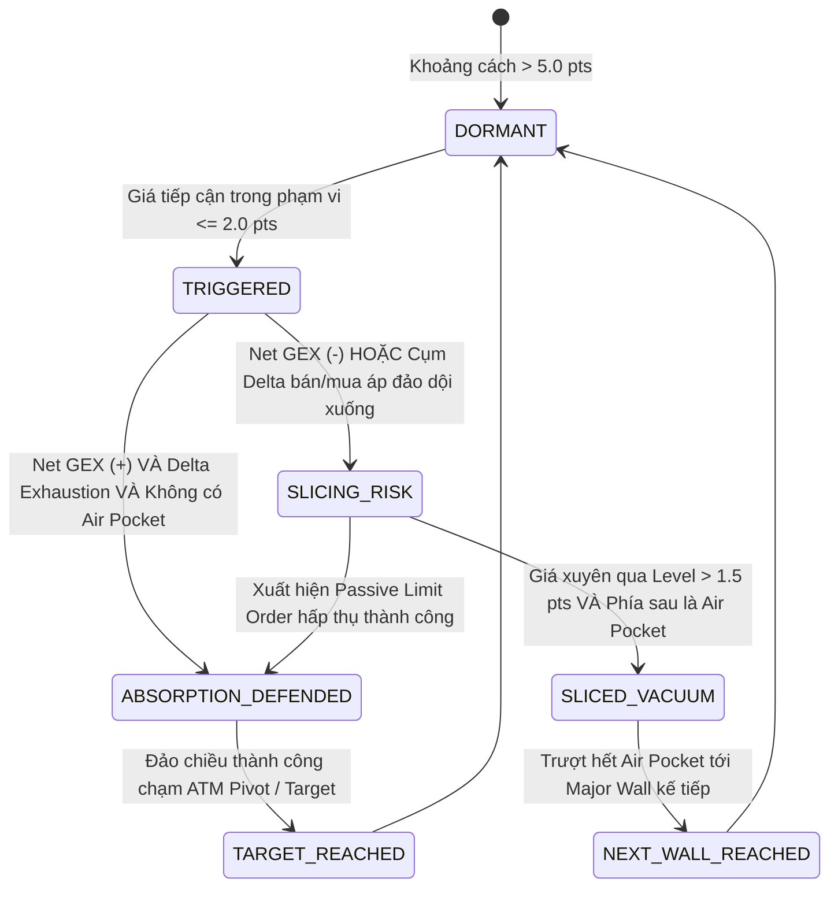

# Neiro-Quant — TÀI LIỆU KIẾN TRÚC HỆ THỐNG ĐỊNH LƯỢNG (QUANT ARCHITECTURE)

> **Phiên bản:** v2.0 — 19/10/2026 (Chuyển giao 100% Cloud-Native Automation)  
> **Project:** Neiro-Quant (Hệ thống Định lượng Options Flow, GEX, DEX, Vanna, Charm & Market Microstructure)  
> **Tài sản mục tiêu:** Vàng CME Futures (`GCZ26`), XAUUSD Spot (Pepperstone / Exness / IC Markets) & E-mini Gold.  
> **Tài liệu chuẩn đối chiếu:** [spec.md](spec.md) & [tailieudacta/CÔNG THỨC CẦN TÍNH TOÁN.md](tailieudacta/CÔNG%20THỨC%20CẦN%20TÍNH%20TOÁN.md)

---

## I. MỤC TIÊU CỐT LÕI & TRIẾT LÝ VẬN HÀNH (FIRST PRINCIPLES)

Thị trường tài chính phái sinh (Futures & Options) được chi phối bởi cấu trúc phòng hộ (Hedging Mechanics) của các Nhà tạo lập thị trường (Market Makers - MMs / Dealers).  
Hệ thống **Neiro-Quant** được xây dựng không phải để đoán mò đỉnh đáy theo các chỉ báo kỹ thuật trễ thông thường (RSI, MACD, MA...), mà nhằm giải quyết 3 bài toán lớn:

1. **Định vị chính xác các chốt chặn thực sự của dòng tiền lớn:**
   - Các bức tường quyền chọn: Call Wall, Put Wall, Absolute Gamma Strike, ATM Synthetic Pivot, ±1.0σ & ±0.85σ Implied Bands.
2. **Giải mã trạng thái động của Chốt chặn khi giá tiếp cận (Real-time Level State Engine):**
   - **Chốt chặn có TRỤ VỮNG không (Absorption & Defense)?** 
     - Xuất hiện lực đỡ/hấp thụ thụ động (Passive Absorption), Delta suy kiệt, nằm trong vùng Positive Net GEX (Dealer buộc phải mua đỡ khi giá rơi, bán ghìm khi giá tăng) -> Kích hoạt lệnh **ĐẢO CHIỀU (Fade Reversal)**.
   - **Hay Chốt chặn sẽ BỊ ĐÂM THỦNG VÀ TRƯỢT DÀI (Sliced & Vacuum Cascade)?**
     - Bên dưới chốt chặn là vùng **Chân không thanh khoản (Air Pocket / Low OI Gap)**, kết hợp Negative Net GEX (Dealer bị ép bán tháo phòng hộ khi giá phá vỡ) -> **TUYỆT ĐỐI CẤM BẮT ĐÁY / ĐỠ DAO**, chuyển trạng thái sang **ĐÁNH PHÁ VỠ (Breakout Vacuum Runner)** ăn trọn con sóng trượt giá.
3. **Vận hành độc lập 100% trên Cloud (Zero-Touch Cloud Automation):**
   - Hoạt động tự động 24/5 trên máy chủ đám mây (GitHub Actions). Không phụ thuộc vào laptop của người dùng, tự động cào dữ liệu, tính toán ma trận Greeks và xuất bản Web Terminal xem trực tiếp trên điện thoại.

---

## II. GIẢI MÃ CA LÂM SÀNG THỰC TẾ (CASE STUDY TỪ BIỂU ĐỒ ORDERFLOW)

Phân tích cấu trúc thực tế từ biểu đồ CME Gold / Orderflow / TrueVision Levels:

```
[4250.00]  ════ Call Wall • Max Call OI ════ (Trần nhà kiên cố của Market Maker)
                  │
[4225.00]  ────── Cửa Ải Kháng Cự Tiền Tuyến (Squeeze > 4227.5 -> MM vỡ trần Short -> Phóng lên 4250)
                  │
[4201.96]  ────── SPOT CME FUTURES (Giá tương lai cân bằng ngầm định via Put-Call Parity)
                  │
[4200.00]  ────── Sàn Đỡ Kỹ Thuật ATM (Đệm Put đỡ nến M5 rút chân)
                  │
                  ▼ ──► [CÚ ĐÂM THỦNG & TRƯỢT DÀI (LIQUIDITY VACUUM / AIR POCKET SLIDE)]
                        Bên dưới 4175 cạn kiệt OI (< 35% trung bình), Dealer buộc phải bán hedge
                        -> Giá trượt tự do không phanh qua 4150
                  ▼
[4100.00]  ════ Major Put Wall • Max Put OI ════ (Đáy bê tông cốt thép cuối cùng của MM)
```

**Bài học cấu trúc:**  
Nếu trader chỉ nhìn vào các đường hỗ trợ kháng cự vẽ tay mà bắt đáy tại các vùng rỗng thanh khoản (Air Pocket), trader sẽ bị quét sạch tài khoản trong cú trượt chân không thanh khoản. Hệ thống **Neiro-Quant** sinh ra để phát hiện trước **nguy cơ bị đâm thủng** và ngăn chặn lệnh bắt đáy tai hại đó.

---

## III. SƠ ĐỒ TOÀN CẢNH KIẾN TRÚC HỆ THỐNG (6 TẦNG ĐỘC LẬP)

```
                    ┌──────────────────────────────────────────────┐
                    │       BARCHART / CME OPTIONS FEED            │
                    │  (Weekly OG1..OG5 & Monthly GCZ Gold Options)│
                    └──────────────────────┬───────────────────────┘
                                           │ Playwright Chromium Cloud + Internal API Sniffer
                                           ▼
┌────────────────────────────────────────────────────────────────────────────────────────┐
│ [TẦNG 1: CLOUD COLLECTOR & AUTOMATION PIPELINE]                                        │
│  - Playwright Headless Chromium: Tự động chạy trên Ubuntu GitHub Actions.              │
│  - Internal API Interceptor: Bắt gói JSON /proxies/core-api/v1/options/get.            │
│  - Dynamic CME Rollover Engine: Tự động giải mã Front-Month Options theo CME Rule       │
│    120102.E (resolve_front_month_cme_option), tự động rollover (OGX26 -> OGZ26...).     │
│  - Dynamic Expiration & DTE: Trích xuất expirationDate từ sàn, tính DTE chính xác.     │
│  - Lưới Cron thích ứng 2 mùa: 07:15 VN (Chốt OI), London 2 nấc (12:30/13:30 & 14:30/15:30),│
│    18:45 VN (Pre-US) & 19:45 đến 23:45 VN (Đón đầu phiên New York & London Fix).           │
│  - Lưu trữ CSV: data/options_prices_GCZ26.csv tự động commit vào repository.           │
└──────────────────────────────────────────┬─────────────────────────────────────────────┘
                                           │
                                           ▼
┌────────────────────────────────────────────────────────────────────────────────────────┐
│ [TẦNG 2: QUANT ENGINE & GREEKS CORE (CÔNG THỨC TOÁN HỌC)]                              │
│  - black76.py: Mô hình Black-76 cho Options on Futures (Call, Put, d1, d2).            │
│  - iv_solver.py: Giải ngược Implied Volatility (Newton-Raphson + Brent fallback).      │
│  - Put-Call Parity Implied Spot: S_Implied = K_ATM + exp(r*T)*(C_ATM - P_ATM).         │
│  - Liquid Strike Weighting: Lọc mốc ATM thực theo Open Interest và Volume thanh khoản. │
│  - gex.py: Net GEX ($/1% move), Gamma Flip Point, Gamma Squeeze / Waterfall Triggers.   │
│  - advanced_greeks.py: Net VEX ($M/1% IV - Vanna) & Net CHEX ($M/ngày - Charm).        │
│  - expected_move.py: Biên độ 1-Sigma (Straddle / 0.7979) & Intraday Rule of 16.        │
└──────────────────────────────────────────┬─────────────────────────────────────────────┘
                                           │
                                           ▼
┌────────────────────────────────────────────────────────────────────────────────────────┐
│ [TẦNG 3: CLOUD TACTICAL TERMINAL & STATIC HOSTING (FRONTEND)]                          │
│  - html_dashboard.py: Render độc lập file Plotly HTML Dark Mode cao cấp.               │
│  - Chế độ ATM ± 5 Strikes (Scalping View): Cắt lớp 10-11 strikes xung quanh ATM.       │
│  - Thuật toán chống đè chữ: Tách rời Legend, lệch tầng Vanna/Charm, đảo bờ nhãn Spot.  │
│  - GitHub Pages Hosting: Xuất bản tự động ra https://daninguyen2509.github.io/Neiro-Quant/ │
│  - Artifacts Storage: Lưu trữ bản build 7 ngày trên GitHub Actions.                    │
│  - Zero Laptop Dependency: Người dùng xem trực tiếp trên điện thoại ở bất kỳ đâu.      │
└──────────────────────────────────────────┬─────────────────────────────────────────────┘
                                           │
                                           ▼
┌────────────────────────────────────────────────────────────────────────────────────────┐
│ [TẦNG 4: MICROSTRUCTURE & LEVEL STATE ENGINE] (src/quant_engine/level_state.py)        │
│  - Giám sát tương tác giữa Giá Real-time và từng Level (State Machine hoàn thiện):     │
│      * DORMANT: Cách xa > 5.0 pts (Chưa tiếp cận).                                     │
│      * TESTING / TRIGGERED: Khoảng cách <= 2.0 pts (Đang chạm chốt chặn).              │
│      * ABSORPTION_DEFENDED: Net GEX (+) + Hấp thụ cạn kiệt -> Tín hiệu FADE REVERSAL.  │
│      * SLICED_VACUUM_RUN: Thủng Level + Phía sau là Air Pocket + Net GEX (-)           │
│        -> Tín hiệu BREAKOUT RUNNER (Cảnh báo CẤM ĐỠ DAO, Target về Major Wall tiếp theo)│
│  - Tự động tích hợp vào Radar Vi Mô và Bảng Tác Chiến Scalping trong HTML Terminal.   │
└──────────────────────────────────────────┬─────────────────────────────────────────────┘
                                           │
                      ┌────────────────────┴────────────────────┐
                      ▼                                         ▼
┌─────────────────────────────────────────┐ ┌────────────────────────────────────────────┐
│ [TẦNG 5: STRATEGY EXECUTION MATRICES]   │ │ [TẦNG 6: REAL-TIME BASIS & BROKER BRIDGE]  │
│  - Bảng 1: Intraday Scalping (Ăn 20-25$)│ │  - Auto-Basis Sync: Live Gold-API & Binance│
│    Entry, Hard SL, TP, Lý do Market     │ │  - Dynamic Basis: S_Spot - F_CME (-24 USD) │
│  - Bảng 2: Structural Swing Walls       │ │  - MetaTrader 5 Connector (Pepperstone)     │
│    Bắt đáy Put Wall / Bán đỉnh Call Wall│ │  - MT5 Indicator: Neiro-Quant-Overlay.mq5   │
└─────────────────────────────────────────┘ └────────────────────────────────────────────┘
```

---

## IV. CƠ CHẾ LƯỚI CRON THÍCH ỨNG 2 MÙA (DUAL-SEASON CLOUD PIPELINE)

Do thị trường tài chính thế giới (London & New York) chuyển đổi qua lại giữa **Giờ mùa hè (Daylight Saving Time - EDT/BST)** và **Giờ mùa đông (Standard Time - EST/GMT)**, hệ thống áp dụng Lưới Cron đa tầng chạy theo giờ UTC tuyệt đối:

```yaml
on:
  schedule:
    # 1. Chốt Open Interest ngày mới từ CME Clearing: 00:15 UTC = 07:15 VN
    - cron: '15 0 * * 1-5'
    # 2. Phiên Âu 2 nấc thích ứng cả 2 mùa (Pre-Europe & In-Session Europe):
    #    05:30 UTC = 12:30 VN (Pre-Europe Mùa Hè: trước Frankfurt 13:00 và London 14:00)
    #    06:30 UTC = 13:30 VN (Pre-Europe Mùa Đông: trước Frankfurt 14:00 và London 15:00)
    #    07:30 UTC = 14:30 VN (In-Session Europe Mùa Hè: sau mở cửa London 30 phút)
    #    08:30 UTC = 15:30 VN (In-Session Europe Mùa Đông: sau mở cửa London 30 phút)
    - cron: '30 5,6,7,8 * * 1-5'
    # 3. Phiên Mỹ đón đầu tin tức vĩ mô (18:45 VN) và giờ cao điểm NYSE / London Fix:
    #    11:45 UTC = 18:45 VN (Pre-US: trước tin CPI/NFP 19:30 hè / 20:30 đông 45 phút)
    #    12:45, 13:45, 14:45, 15:45, 16:45 UTC (19:45, 20:45, 21:45, 22:45, 23:45 VN)
    - cron: '45 11,12,13,14,15,16 * * 1-5'
```

* **Phiên Á:** Chốt toàn bộ dữ liệu vị thế Open Interest (OI) của ngày hôm trước từ CME Clearing lúc 07:15 VN để định hình khung Asian Range.
* **Phiên Âu (2 nấc):** Cào nấc 1 (12:30 / 13:30 VN) để lên bản đồ tác chiến trước giờ G (Pre-Europe Radar). Cào nấc 2 (14:30 / 15:30 VN) để cập nhật Greeks và dịch chuyển Gamma sau khi dòng tiền London hấp thụ.
* **Phiên Mỹ:** Đón đầu trước tin vĩ mô lúc 18:45 VN, sau đó chạy đều mỗi 1 tiếng bao trọn giờ mở cửa sàn chứng khoán New York (NYSE) và đợt chốt sổ London Fix (00:00 VN).
* **Hạn mức tài nguyên:** 11 lần chạy/ngày $\times$ 1.5 phút $\approx$ **360 phút/tháng** (chỉ chiếm ~18% hạn mức 2,000 phút miễn phí của GitHub Actions, 100% miễn phí).

---

## V. CƠ CHẾ STATE MACHINE CHO TỪNG LEVEL (LEVEL STATE ENGINE)

Mỗi đường Level được hệ thống theo dõi 24/7 theo chu trình trạng thái khép kín:



### 1. Trạng thái `DORMANT` (Chờ kích hoạt)
- Giá hiện tại cách Level > 5.0 USD (với Gold).
- Level đóng vai trò là mốc định hướng trên bản đồ thanh khoản lớn.

### 2. Trạng thái `TRIGGERED / TESTING` (Đang tiếp cận & thử thách)
- Giá chạm vào phạm vi đệm `[Level - 2.0, Level + 2.0]`.
- Hệ thống kích hoạt radar phân tích vi mô:
  - Kiểm tra Net GEX tại Strike (Dương hay Âm?).
  - Đo tốc độ nến và khối lượng giao dịch dồn tụ.

### 3. Trạng thái `ABSORPTION_DEFENDED` (Chốt chặn trụ vững)
- **Điều kiện kích hoạt:**
  1. Net GEX tại Strike mang giá trị **DƯƠNG (+GEX)**: Dealer đóng vai trò đè nén dao động.
  2. Nến M5 rút chân trở lại vào trong vùng cản (Passive Absorption).
  3. Delta suy kiệt.
- **Quy tắc vào lệnh (Fade Reversal):**
  - **Entry:** Vào lệnh khi nến M1/M5 đóng cửa rút chân trở lại vào trong vùng cản.
  - **Stop Loss (SL):** Đặt cách mép ngoài của chốt chặn **1.5 - 2.5 giá**.
  - **Take Profit (TP):** Trục cân bằng ngầm định `S_Implied` (ATM Pivot) hoặc mốc cản đối diện.

### 4. Trạng thái `SLICED_VACUUM_RUN` (Chốt chặn bị đâm thủng - Trượt dốc)
- **Điều kiện kích hoạt:**
  1. Giá đóng cửa xuyên thủng qua Level > 1.5 giá.
  2. Phía sau Level là một **Air Pocket (Vùng rỗng thanh khoản)** có OI mỏng (< 35% trung bình).
  3. Net GEX mang giá trị **ÂM (-GEX)**: Dealer bị ép bán tháo phòng hộ.
- **Quy tắc ứng xử & Vào lệnh (Breakout Runner):**
  - **Lệnh cấm tối cao:** **TUYỆT ĐỐI KHÔNG BẮT ĐÁY / KHÔNG ĐỠ DAO**.
  - **Entry:** Đánh theo đà phá vỡ (Breakout Entry) ngay khi xác nhận nến đóng ngoài Level.
  - **Stop Loss (SL):** Đặt ngay phía trên Level vừa bị thủng 1.0 - 1.5 giá.
  - **Take Profit (TP):** Biên trên của Bức tường OI/GEX dày tiếp theo (Ăn trọn khoảng chân không Air Pocket).

---

## VI. BẢNG THÔNG SỐ CẤU HÌNH HỆ THỐNG (SETTINGS SPECIFICATION)

| Thông số | Giá trị | Ý nghĩa kỹ thuật |
|---|---|---|
| `underlying_symbol` | `GCZ26` / `GC` | Mã hợp đồng tương lai vàng CME |
| `spot_symbols` | `XAUUSD`, `XAUUSDc`, `XAUUSD-F` | Mã tài sản giao dịch trên sàn MT5 |
| `multiplier` | `100` | 100 troy oz mỗi CME Gold Contract |
| `risk_free_rate` | `0.045` (4.5%) | Lãi suất phi rủi ro chuẩn định giá Black-76 |
| `dte_days` | `38.0` | Số ngày còn lại tới ngày đáo hạn hợp đồng |
| `proximity_threshold` | `2.0` | Ngưỡng $ kích hoạt trạng thái TESTING |
| `breakout_threshold` | `1.5` | Ngưỡng $ xác nhận xuyên thủng Level |
| `air_pocket_threshold` | `< 0.35` | Tỷ lệ OI so với trung bình để định danh Air Pocket |
| `web_terminal_url` | `https://daninguyen2509.github.io/Neiro-Quant/` | Địa chỉ Web Terminal mở trên điện thoại |

---

## VII. QUY ĐỊNH BẢO TỒN DUNG LƯỢNG & HIỆU NĂNG (ZERO-WASTE MANDATE)

1. **Chuẩn dung lượng siêu nhẹ:** Toàn bộ repository luôn được duy trì < 15MB.
2. **Loại bỏ hoàn toàn rác tạm:** Mọi file cào tạm thời, script scratch, file log thử nghiệm phải bị xóa sạch ngay sau khi hoàn thành.
3. **Cloud-First:** Tính toán hoàn toàn trên đám mây, không cài đặt dữ liệu nặng vào ổ cứng của người dùng.
4. **Không phụ thuộc Laptop:** Toàn bộ luồng sinh dữ liệu và xuất bản giao diện vận hành trơn tru ngay cả khi laptop tắt nguồn.
