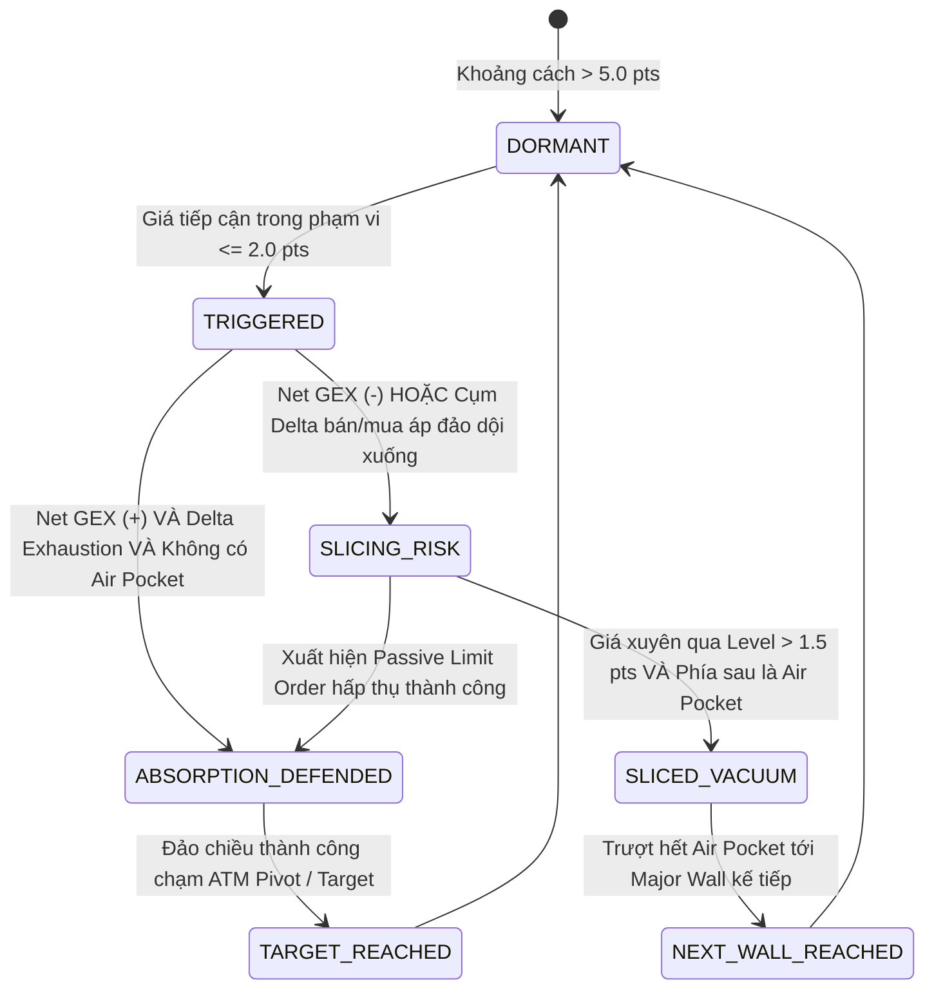

# Neiro-Quant — TÀI LIỆU KIẾN TRÚC HỆ THỐNG ĐỊNH LƯỢNG (QUANT ARCHITECTURE)

> **Phiên bản:** v1.0 — 18/10/2026  
> **Project:** Neiro-Quant (Hệ thống Định lượng Options Flow, GEX, DEX & Market Microstructure)  
> **Tài sản mục tiêu:** Vàng CME Futures (`GC`), XAUUSD Spot (Pepperstone / Exness / IC Markets) & Nasdaq Futures (`NQ`).  
> **Tài liệu đối chiếu:** [spec.md](spec.md) & [tailieudacta/CÔNG THỨC CẦN TÍNH TOÁN.md](tailieudacta/CÔNG%20THỨC%20CẦN%20TÍNH%20TOÁN.md)

---

## I. MỤC TIÊU CỐT LÕI & TRIẾT LÝ VẬN HÀNH (FIRST PRINCIPLES)

Thị trường tài chính phái sinh (Futures & Options) được chi phối bởi cấu trúc phòng hộ (Hedging Mechanics) của các Nhà tạo lập thị trường (Market Makers - MMs / Dealers).  
Hệ thống **Neiro-Quant** được xây dựng không phải để đoán mò đỉnh đáy theo các chỉ báo kỹ thuật trễ thông thường (RSI, MACD, MA...), mà nhằm giải quyết 3 bài toán lớn:

1. **Định vị chính xác các chốt chặn thực sự của dòng tiền lớn:**
   - Các bức tường quyền chọn: Call Wall, Put Wall, Absolute Gamma Strike, ATM Synthetic Pivot, ±1.0σ & ±0.85σ Implied Bands.
2. **Giải mã trạng thái động của Chốt chặn khi giá tiếp cận (Real-time Level State Engine):**
   - **Chốt chặn có TRỤ VỮNG không (Absorption & Defense)?** 
     - Xuất hiện lực đỡ/hấp thụ thụ động (Passive Absorption), Delta suy kiệt, nằm trong vùng Positive Net GEX (Dealer buộc phải mua đỡ khi giá rơi, bán ghìm khi giá tăng) -> Kích hoạt lệnh **ĐẢO CHIỀU (Fade Reversal)**.
   - **Hay Chốt chặn sẽ BỊ ĐÂM THỦNG VÀ TRƯỢT DÀI (Sliced & Vacuum Cascade)?**
     - Bên dưới chốt chặn là vùng **Chân không thanh khoản (Air Pocket / Low OI Gap)**, kết hợp Negative Net GEX (Dealer bị ép bán tháo phòng hộ khi giá phá vỡ) -> **TUYỆT ĐỐI CẤM BẮT ĐÁY / ĐỠ DAO**, chuyển trạng thái sang **ĐÁNH PHÁ VỠ (Breakout Vacuum Runner)** ăn trọn con sóng trượt giá.
3. **Chuẩn hóa điểm vào lệnh (Precision Execution):**
   - Entry vào đúng thời điểm xác nhận phản ứng vi mô (không FOMO).
   - Stop Loss cực ngắn (1.5 - 2.5 giá) đặt ngay sau lưng cấu trúc hấp thụ/vùng cản.
   - Take Profit nhắm thẳng tới trung tâm hồi quy (ATM Pivot) hoặc mép thanh khoản đón giá tiếp theo.

---

## II. GIẢI MÃ CA LÂM SÀNG THỰC TẾ (CASE STUDY TỪ BIỂU ĐỒ ORDERFLOW)

Phân tích cấu trúc thực tế từ biểu đồ NQZ6 / Rithmic / TrueVision Levels:

```
[31287.50]  ════ Put Wall • Gamma C • Gamma P • DEX P • #1 OI Put ════  (Bức tường Put Wall vĩ mô)
                   │
[31280 - 72]      ├── deep ef stack (Cụm lệnh Limit xếp tầng dày đặc thử thách đà rơi)
                   │
[31265 - 62]      ├── buyer abs (Buyer Absorption — Phe mua cố gắng đỡ nhưng cạn kiệt lực)
                   │
[31255 - 52]      ├── seller offer (Cụm Footprint mất cân bằng bán: 59, 37, 30, 35 dội xuống)
                   │
[31246.00]  ════ gex 5 reaction (#5 Gamma Level — Phản ứng giằng co nhẹ) ════
                   │
                   ▼ ──► [CÚ ĐÂM THỦNG & TRƯỢT DÀI (LIQUIDITY VACUUM / AIR POCKET SLIDE)]
                         Bên dưới 31246 cạn kiệt thanh khoản Bid, Dealer buộc phải bán hedge
                         -> Giá trượt tự do không phanh qua 31214.00
                   ▼
[31187.50]  ════ Vùng cụm thanh khoản Bid / OI kế tiếp mới đón và chặn đứng được giá ════
```

**Bài học cấu trúc:**  
Nếu trader chỉ nhìn vào đường 31246 (GEX #5) mà nhảy vào bắt đáy với niềm tin mù quáng rằng "đây là cản cứng", trader sẽ bị quét sạch tài khoản trong cú trượt chân không thanh khoản xuống 31187.  
Hệ thống **Neiro-Quant** sinh ra để phát hiện trước **nguy cơ bị đâm thủng** và ngăn chặn lệnh bắt đáy tai hại đó.

---

## III. SƠ ĐỒ TOÀN CẢNH KIẾN TRÚC HỆ THỐNG (6 TẦNG ĐỘC LẬP)

```
                    ┌──────────────────────────────────────────────┐
                    │       BARCHART / CME OPTIONS FEED            │
                    │  (Weekly OG1..OG5 & Monthly OG Gold Options) │
                    └──────────────────────┬───────────────────────┘
                                           │ Playwright Headless + XHR Sniffer
                                           ▼
┌────────────────────────────────────────────────────────────────────────────────────────┐
│ [TẦNG 1: COLLECTOR & EXPIRY AUTO-RESOLVER]                                             │
│  - symbols.py: Xây dựng CME root symbol & URL query động.                             │
│  - expiry_resolver.py: Tự động phát hiện ngày/thứ trong tháng (OG1..OG5).             │
│    Tuần cuối tháng/quý/năm: Kích hoạt chế độ Dual-frame (Weekly + Monthly).            │
│  - scraper.py: Intercept trực tiếp XHR JSON nội bộ từ Barchart (vượt HTTP 202).       │
│  - parser.py: Chuẩn hóa thành OptionsSnapshot & OptionsStrike.                        │
└──────────────────────────────────────────┬─────────────────────────────────────────────┘
                                           │
                                           ▼
┌────────────────────────────────────────────────────────────────────────────────────────┐
│ [TẦNG 2: QUANT ENGINE & GREEKS CORE (CÔNG THỨC TOÁN HỌC)]                              │
│  - black76.py: Mô hình Black-76 cho Options on Futures (Call, Put, d1, d2).            │
│  - iv_solver.py: Giải ngược Implied Volatility (Newton-Raphson + Brent fallback)       │
│    -> Giải quyết triệt để lỗi Barchart trả IV = 0.00% ngày 0DTE.                       │
│  - greeks.py: Đạo hàm bậc 1 & bậc 2 (Delta, Gamma, Theta, Vega, Rho).                  │
│  - gex.py: GEX ($/1% move), DEX ($ Exposure), Net GEX, Gamma Flip Point.               │
│  - advanced_greeks.py: VEX (Vanna Exposure) & CHEX (Charm Exposure).                   │
│  - synthetic.py: K_ATM, Synthetic Futures S_Implied, Straddle, ±1.0σ & ±0.85σ Bands.   │
│  - air_pocket.py: Thuật toán quét chân không thanh khoản (OI < 35% trung bình).        │
│  - dealer.py: Major Call Wall, Put Wall, Absolute Gamma Strike, Pin Risk.              │
└──────────────────────────────────────────┬─────────────────────────────────────────────┘
                                           │
                                           ▼
┌────────────────────────────────────────────────────────────────────────────────────────┐
│ [TẦNG 3: REAL-TIME BASIS SYNC & BROKER BRIDGE]                                         │
│  - connector.py: Kết nối MetaTrader 5 Python API (Pepperstone, Exness, IC Markets).    │
│  - price_feed.py: Event-driven tick listener cho XAUUSD Spot & Futures.                │
│  - basis_sync.py: Tính toán độ lệch Basis = Futures - Spot theo Rolling Window (60s):   │
│         Level_Spot = Level_Futures - Basis_Spread                                      │
│    Chiếu toàn bộ các mốc cản CME chuẩn xác từng pip lên biểu đồ Spot của sàn.          │
└──────────────────────────────────────────┬─────────────────────────────────────────────┘
                                           │
                                           ▼
┌────────────────────────────────────────────────────────────────────────────────────────┐
│ [TẦNG 4: MICROSTRUCTURE & LEVEL STATE ENGINE]                                          │
│  - Giám sát tương tác giữa Giá Real-time và từng Level:                                │
│      * DORMANT: Cách xa > 5.0 pts (Chưa tiếp cận).                                     │
│      * TESTING / TRIGGERED: Khoảng cách <= 2.0 pts (Đang chạm chốt chặn).              │
│      * ABSORPTION_DEFENDED: Net GEX (+) + Delta cạn kiệt -> Tín hiệu FADE REVERSAL.    │
│      * SLICED_VACUUM_RUN: Thủng Level + Phía sau là Air Pocket + Net GEX (-)           │
│        -> Tín hiệu BREAKOUT RUNNER (Cảnh báo CẤM ĐỠ DAO).                              │
└──────────────────────────────────────────┬─────────────────────────────────────────────┘
                                           │
                                           ▼
┌────────────────────────────────────────────────────────────────────────────────────────┐
│ [TẦNG 5: DISPATCHER & REALTIME CACHE]                                                  │
│  - levels_cache.json: Ghi nhận snapshot levels liên tục cho các hệ thống ngoại vi.     │
│  - WebSocket Server (FastAPI): Truyền stream dữ liệu siêu tốc (< 50ms) tới Web UI.    │
└──────────────────────────────────────────┬─────────────────────────────────────────────┘
                                           │
                     ┌─────────────────────┴─────────────────────┐
                     ▼                                           ▼
┌─────────────────────────────────────────┐ ┌────────────────────────────────────────────┐
│ [TẦNG 6A: WEB COCKPIT DASHBOARD]        │ │ [TẦNG 6B: MT5 / TRADINGVIEW OVERLAY]       │
│  - Localhost:8080 (Dark Theme ATAS)     │ │  - MT5 Indicator: Neiro-Quant-Overlay.mq5  │
│  - Radar Matrix: Giám sát trạng thái    │ │    đọc levels_cache.json vẽ trực tiếp hộp   │
│    từng level theo thời gian thực       │ │    vùng cản & Air Pocket lên nến MT5.       │
│  - GEX Profile Bar Chart từng Strike    │ │  - TradingView Pine Script Indicator       │
│  - Actionable Cards: Khuyến nghị        │ │    (Neiro-Quant-Overlay.pine).             │
│    vào lệnh, SL, TP rõ ràng, tức thì    │ │                                            │
└─────────────────────────────────────────┘ └────────────────────────────────────────────┘
```

---

## IV. CƠ CHẾ STATE MACHINE CHO TỪNG LEVEL (LEVEL STATE ENGINE)

Mỗi đường Level được hệ thống theo dõi 24/7 theo chu trình trạng thái khép kín:



### 1. Trạng thái `DORMANT` (Chờ kích hoạt)
- Giá hiện tại cách Level > 5.0 USD (với Gold) hoặc > 20 ticks (với NQ).
- Level đóng vai trò là mốc định hướng trên bản đồ thanh khoản lớn.

### 2. Trạng thái `TRIGGERED / TESTING` (Đang tiếp cận & thử thách)
- Giá chạm vào phạm vi đệm `[Level - 2.0, Level + 2.0]`.
- Hệ thống kích hoạt radar phân tích vi mô:
  - Kiểm tra Net GEX tại Strike (Dương hay Âm?).
  - Đo tốc độ nến (Tick velocity) và tỷ lệ mất cân bằng (Footprint Imbalance).

### 3. Trạng thái `ABSORPTION_DEFENDED` (Chốt chặn trụ vững)
- **Điều kiện kích hoạt:**
  1. Net GEX tại Strike mang giá trị **DƯƠNG (+GEX)**: Dealer đóng vai trò đè nén dao động.
  2. Khối lượng khớp chủ động (Market orders) lớn nhưng nến rút chân hoặc dao động giằng co hẹp (Passive Absorption).
  3. Delta phân kỳ kiệt sức (Delta Exhaustion).
- **Quy tắc vào lệnh (Fade Reversal):**
  - **Entry:** Vào lệnh khi nến M1/M5 đóng cửa rút chân trở lại vào trong vùng cản.
  - **Stop Loss (SL):** Đặt cách mép ngoài của chốt chặn **1.5 - 2.5 giá**.
  - **Take Profit (TP):** 
    - TP1: Trục cân bằng ngầm định `S_Implied` (ATM Pivot).
    - TP2: Mép cản đối diện (Call Wall nếu Buy, Put Wall nếu Sell).

### 4. Trạng thái `SLICED_VACUUM_RUN` (Chốt chặn bị đâm thủng - Trượt dốc)
- **Điều kiện kích hoạt:**
  1. Giá đóng cửa xuyên thủng qua Level > 1.5 giá.
  2. Phía sau Level là một **Air Pocket (Vùng rỗng thanh khoản)** có OI mỏng (< 35% trung bình).
  3. Net GEX mang giá trị **ÂM (-GEX)**: Dealer bị ép bán/mua đuổi theo hướng phá vỡ để phòng hộ.
- **Quy tắc ứng xử & Vào lệnh (Breakout Runner):**
  - **Lệnh cấm tối cao:** **TUYỆT ĐỐI KHÔNG BẮT ĐÁY / KHÔNG ĐỠ DAO**.
  - **Entry:** Đánh theo đà phá vỡ (Breakout Entry) ngay khi xác nhận nến đóng ngoài Level.
  - **Stop Loss (SL):** Đặt ngay phía trên Level vừa bị thủng 1.0 - 1.5 giá.
  - **Take Profit (TP):** Biên trên của Bức tường OI/GEX dày tiếp theo (Ăn trọn khoảng chân không Air Pocket).

---

## V. CƠ CHẾ EXPIRY RESOLVER & DUAL-FRAME (CHỌN KỲ HẠN ĐÁO HẠN)

Hệ thống tự động giải mã chu kỳ đáo hạn của sàn CME:
- **Tuần 1 -> Tuần 4 bình thường:** Thu thập hợp đồng Weekly tương ứng (`OG1`, `OG2`, `OG3`, `OG4`, `OG5`).
- **Tuần cuối tháng / cuối quý / cuối năm:**
  - Tự động kích hoạt cơ chế **Dual-Frame**: Tính toán và hiển thị **SONG SONG cả 2 bộ Levels (Weekly + Monthly)**.
  - Hợp đồng Monthly (`OG`) phản ánh dòng tiền vị thế lớn của các quỹ tổ chức (Institutional Hedging).
  - Hợp đồng Weekly phản ánh biến động ngắn hạn trong tuần.

---

## VI. BẢNG THÔNG SỐ CẤU HÌNH HỆ THỐNG (SETTINGS SPECIFICATION)

| Thông số | Giá trị | Ý nghĩa kỹ thuật |
|---|---|---|
| `underlying_symbol` | `GCZ26` / `GC` | Mã hợp đồng tương lai vàng CME |
| `spot_symbols` | `XAUUSD`, `XAUUSDc`, `XAUUSD-F` | Mã tài sản giao dịch trên sàn MT5 |
| `multiplier` | `100` | 100 troy oz mỗi CME Gold Contract |
| `proximity_threshold` | `2.0` | Ngưỡng $ kích hoạt trạng thái TESTING |
| `breakout_threshold` | `1.5` | Ngưỡng $ xác nhận xuyên thủng Level |
| `air_pocket_threshold` | `< 0.35` | Tỷ lệ OI so với trung bình để định danh Air Pocket |
| `basis_window_seconds`| `60` | Cửa sổ trượt tính trung vị Basis Spread |
| `dashboard_port` | `8080` | Cổng Web Cockpit UI trên máy local |

---

## VII. ĐỘNG LỰC VÀ TIÊU CHUẨN MÃ NGUỒN

- **Zero-Touch Automation:** Chạy ngầm 24/7, tự kết nối lại nếu rớt mạng, tự động fetch lãi suất và Greeks.
- **Tiêu tốn tài nguyên tối thiểu:** CPU < 5%, RAM < 250MB.
- **Tính toán chính xác tuyệt đối:** Mọi module toán học (Black-76, Greeks, GEX) phải vượt qua 100% Unit Tests với Golden Values từ thị trường trước khi cấp dữ liệu cho Dashboard.
