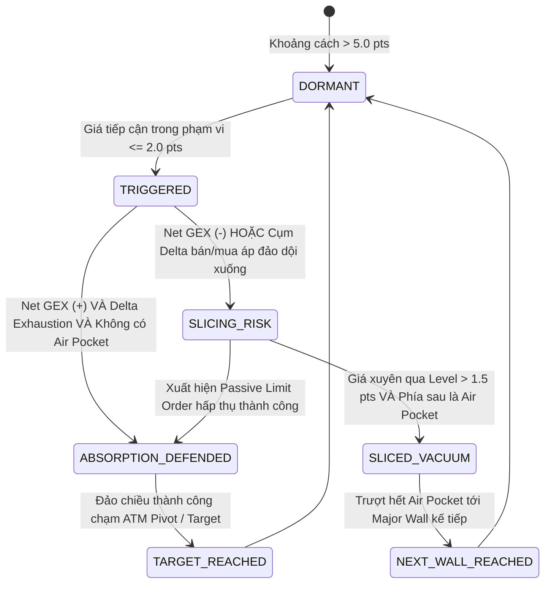

# Neiro-Quant — TÀI LIỆU KIẾN TRÚC HỆ THỐNG ĐỊNH LƯỢNG (QUANT ARCHITECTURE)

> **Phiên bản:** v2.2 — 20/10/2026 (Chuẩn hóa OTM Dealer Walls, M5 Orderflow Pulse & Anti-Cache Dashboard)  
> **Project:** Neiro-Quant (Hệ thống Định lượng Options Flow, GEX, DEX, Vanna, Charm & Market Microstructure)  
> **Tài sản mục tiêu:** Vàng CME Futures (`GCZ26` / `GC=F`) & COMEX Gold Options.  
> **Tài liệu chuẩn đối chiếu:** [spec.md](spec.md) & [decisions/ADR-006-pure-cme-futures-and-realtime-scenario-engine.md](decisions/ADR-006-pure-cme-futures-and-realtime-scenario-engine.md)

---

## I. MỤC TIÊU CỐT LÕI & TRIẾT LÝ VẬN HÀNH (FIRST PRINCIPLES)

Thị trường tài chính phái sinh (Futures & Options) được chi phối bởi cấu trúc phòng hộ (Hedging Mechanics) của các Nhà tạo lập thị trường (Market Makers - MMs / Dealers).  
Hệ thống **Neiro-Quant** được xây dựng không phải để đoán mò đỉnh đáy theo các chỉ báo kỹ thuật trễ thông thường (RSI, MACD, MA...), mà nhằm giải quyết các bài toán định lượng:

1. **Định vị chính xác các chốt chặn thực sự của dòng tiền lớn:**
   - Các bức tường quyền chọn: Call Wall, Put Wall, Absolute Gamma Strike, ATM Realtime Pivot, ±1.0σ & ±0.85σ Implied Bands.
   - Định vị 100% thuần theo Giá tương lai CME Gold Futures Realtime (`GC=F`), khóa chặt trục ATM theo bảng điện trực tiếp.
   - **Quy tắc khóa OTM Dealer Walls:** Call Wall bắt buộc là OTM Call ($strike \ge spot$), Put Wall bắt buộc là OTM Put ($strike \le spot$), triệt tiêu hoàn toàn rủi ro lấy nhầm Strike ITM làm sàn/trần.
2. **Giải mã trạng thái động và kích hoạt kịch bản tức thì (6-Scenario Realtime Engine):**
   - Đánh giá trực tiếp trong thời gian thực hành vi của Market Maker theo 6 kịch bản (KB-1 đến KB-6):
     * **KB-1 (Giằng co nén biên độ):** MM ghìm giá ăn phế -> ĐỨNG NGOÀI.
     * **KB-2 (MM chặn bán):** MM bảo vệ trần Call -> SELL FADE.
     * **KB-3 (MM vỡ trận Short - Gamma Squeeze):** Vượt trần phòng hộ -> BUY BREAKOUT.
     * **KB-4 (MM đệm mua):** MM bảo vệ sàn Put -> BUY REBOUND.
     * **KB-5 (Thủng sàn & Xả lũ - Air Pocket Slide):** Rơi vào Air Pocket -> CẤM ĐỠ DAO / SELL BREAKDOWN.
     * **KB-6 (Vùng trung lập):** Chưa chạm mốc -> KIÊN NHẪN CHỜ.
   - **Giao diện ma trận chống hiểu lầm:** Thẻ chờ tín hiệu được làm mờ 55% opacity, viền xám tối, nhãn hành động mang đuôi `(Chưa áp dụng)`. Chỉ kích hoạt phát sáng khi giá thực tế chạm hoặc xuyên thủng ngưỡng.
   - **Quy tắc bất biến cho Take-Profit (Invariant Enforcement):** Đối với kịch bản Mean-Reversion (KB-2 & KB-4), khi mốc biên cản trùng với trục ATM, hệ thống tự động dội mục tiêu về biên đối diện (`strike_below` hoặc `strike_above`), luôn đảm bảo nghiêm ngặt $TP < Entry$ cho lệnh SELL và $TP > Entry$ cho lệnh BUY.
3. **Băng Giá & Xung Lực Volume M5 Realtime (Orderflow Pulse Radar):**
   - Theo dõi luồng nến M5 trực tiếp từ COMEX, phát hiện Volume Spike ($Volume \ge 1.4 \times MA_{20}$) và nhận diện vi mô hấp thụ đáy rút chân hoặc chặn bán đè đỉnh.
3. **Bảng Tác Chiến Tức Thì (Instant Action UI):**
   - Giúp trader trong 3 giây nắm bắt ngay hành động cụ thể (Action), điểm vào lệnh, cắt lỗ, chốt lời.
   - Tối giản chữ, tuyệt đối không dùng icon trang trí rườm rà.
4. **Vận hành độc lập 100% trên Cloud (Zero-Touch Cloud Automation):**
   - Hoạt động tự động 24/5 trên máy chủ đám mây (GitHub Actions). Không phụ thuộc vào laptop của người dùng, tự động cào dữ liệu, tính toán ma trận Greeks và xuất bản Web Terminal xem trực tiếp trên điện thoại.

---

## II. GIẢI MÃ CA LÂM SÀNG THỰC TẾ (CASE STUDY TỪ BIỂU ĐỒ ORDERFLOW)

Phân tích cấu trúc thực tế từ biểu đồ CME Gold / Orderflow / TrueVision Levels:

```
[4250.00]  ════ Call Wall • Max Call OI ════ (Trần nhà kiên cố của Market Maker)
                  │
[4225.00]  ────── Cửa Ải Kháng Cự Tiền Tuyến (Squeeze > 4227.5 -> MM vỡ trần Short -> Phóng lên 4250)
                  │
[4201.96]  ────── SPOT CME FUTURES (Giá tương lai cân bằng ngầm định via Put-Call Parity)
                  │
[4200.00]  ────── Sàn Đỡ Kỹ Thuật ATM (Đệm Put đỡ nến M5 rút chân)
                  │
                  ▼ ──► [CÚ ĐÂM THỦNG & TRƯỢT DÀI (LIQUIDITY VACUUM / AIR POCKET SLIDE)]
                        Bên dưới 4175 cạn kiệt OI (< 35% trung bình), Dealer buộc phải bán hedge
                        -> Giá trượt tự do không phanh qua 4150
                  ▼
[4100.00]  ════ Major Put Wall • Max Put OI ════ (Đáy bê tông cốt thép cuối cùng của MM)
```

**Bài học cấu trúc:**  
Nếu trader chỉ nhìn vào các đường hỗ trợ kháng cự vẽ tay mà bắt đáy tại các vùng rỗng thanh khoản (Air Pocket), trader sẽ bị quét sạch tài khoản trong cú trượt chân không thanh khoản. Hệ thống **Neiro-Quant** sinh ra để phát hiện trước **nguy cơ bị đâm thủng** và ngăn chặn lệnh bắt đáy tai hại đó.

---

## III. SƠ ĐỒ TOÀN CẢNH KIẾN TRÚC HỆ THỐNG (6 TẦNG ĐỘC LẬP)

```
                    ┌──────────────────────────────────────────────┐
                    │       BARCHART / CME OPTIONS FEED            │
                    │  (Weekly OG1..OG5 & Monthly GCZ Gold Options)│
                    └──────────────────────┬───────────────────────┘
                                           │ Playwright Chromium Cloud + Internal API Sniffer
                                           ▼
┌────────────────────────────────────────────────────────────────────────────────────────┐
│ [TẦNG 1: CLOUD COLLECTOR & AUTOMATION PIPELINE]                                        │
│  - Playwright Headless Chromium: Tự động chạy trên Ubuntu GitHub Actions.              │
│  - Internal API Interceptor: Bắt gói JSON /proxies/core-api/v1/options/get.            │
│  - Dynamic CME Rollover Engine: Tự động giải mã Front-Month Options theo CME Rule       │
│    120102.E (resolve_front_month_cme_option), tự động rollover (OGX26 -> OGZ26...).     │
│  - Dynamic Expiration & DTE: Trích xuất expirationDate từ sàn, tính DTE chính xác.     │
│  - Lưới Cron thích ứng 2 mùa: 07:15 VN (Chốt OI), London 2 nấc (12:30/13:30 & 14:30/15:30),│
│    18:45 VN (Pre-US) & 19:45 đến 23:45 VN (Đón đầu phiên New York & London Fix).           │
│  - Real-Time Dual-Feed Engine (ADR-005): Tự động kéo giá CME Futures (yfinance GC=F)     │
│    kết hợp Spot Gold (Gold-API/Binance PAXG), tính toán Dynamic Basis Contango [5, 32] USD.│
│  - Lưu trữ CSV: data/options_prices_GCZ26.csv tự động commit vào repository.           │
└──────────────────────────────────────────┬─────────────────────────────────────────────┘
                                           │
                                           ▼
┌────────────────────────────────────────────────────────────────────────────────────────┐
│ [TẦNG 2: QUANT ENGINE & GREEKS CORE (CÔNG THỨC TOÁN HỌC)]                              │
│  - black76.py: Mô hình Black-76 cho Options on Futures (Call, Put, d1, d2).            │
│  - iv_solver.py: Giải ngược Implied Volatility (Newton-Raphson + Brent fallback).      │
│  - Put-Call Parity Implied Spot: S_Implied = K_ATM + exp(r*T)*(C_ATM - P_ATM).         │
│  - Liquid Strike Weighting: Lọc mốc ATM thực theo Open Interest và Volume thanh khoản. │
│  - dealer.py: Zero Gamma Continuous Solver (_brentq Dekker-Brent), Wall Siege Ratio    │
│    (compute_wall_siege_ratio), Dealer Net Delta Position (compute_net_delta_positions),│
│    Call/Put Walls, Gamma Flip, Squeeze Triggers.                                       │
│  - advanced_greeks.py: Net VEX ($M/1% IV - Vanna) & Net CHEX ($M/ngày - Charm).        │
│  - expected_move.py: Biên độ 1-Sigma (Straddle / 0.7979) & Intraday Rule of 16.        │
│  - institutional.py: 25Δ Risk Reversal (RR25), Butterfly (BF25), Volatility-Targeted   │
│    Position Sizing với GEX Regime Scaler & CTA 20-Day Momentum Confluence.             │
└──────────────────────────────────────────┬─────────────────────────────────────────────┘
                                           │
                                           ▼
┌────────────────────────────────────────────────────────────────────────────────────────┐
│ [TẦNG 3: CLOUD TACTICAL TERMINAL & STATIC HOSTING (FRONTEND)]                          │
│  - html_dashboard.py: Render độc lập file Plotly HTML Dark Mode cao cấp.               │
│  - 100% Pure CME Gold Futures Engine: Định vị chuẩn xác theo giá COMEX GC=F / GCZ26,   │
│    loại bỏ hoàn toàn cơ chế lấy Spot Gold (Gold-API/Binance PAXG) và hiệu chỉnh Basis. │
│    Triệt tiêu 100% hiện tượng sai lệch giá và báo động giả.                             │
│  - 7 Thẻ KPI Thống Kê: Spot CME, Net GEX Regime, Sổ Sách Dealer (Net Delta / DEX),     │
│    Zero Gamma Flip ($S*) & Wall Siege, Expected Move, Greeks Bậc 2, 25Δ Skew.          │
│  - Plotly Panel 2: Trực quan hóa thanh Net Delta Bar (HĐ GC) và Hover Tooltip chi tiết │
│    Call/Put/Net contracts từng Strike.                                                 │
│  - Đường Zero Gamma Flip ($S*): Vẽ trực quan trên Panel 1, đánh dấu ranh giới đảo chiều.│
│  - Visual Level Spine: Thước đo vị trí giá tích hợp tỷ lệ Siege tại Call/Put Wall.     │
│  - Institutional Pinning Radar: Cảnh báo tự động hiện tượng Neo giá (Pinning Box).     │
│  - CTA Momentum Confluence Banner: Cảnh báo bứt phá đồng pha giữa Quỹ & Dealer.        │
│  - Chế độ ATM Broad Tactical View: Tự động co giãn dải strikes bao trọn Walls & Flip.  │
│  - Thuật toán chống đè chữ: Tách rời Legend, lệch tầng Vanna/Charm, đảo bờ nhãn Spot.  │
│  - GitHub Pages Hosting: Xuất bản tự động ra https://daninguyen2509.github.io/Neiro-Quant/ │
│  - Artifacts Storage: Lưu trữ bản build 7 ngày trên GitHub Actions.                    │
│  - Zero Laptop Dependency: Người dùng xem trực tiếp trên điện thoại ở bất kỳ đâu.      │
└──────────────────────────────────────────┬─────────────────────────────────────────────┘
                                           │
                                           ▼
┌────────────────────────────────────────────────────────────────────────────────────────┐
│ [TẦNG 4: MICROSTRUCTURE & LEVEL STATE ENGINE] (src/quant_engine/level_state.py)        │
│  - Giám sát tương tác giữa Giá Real-time và từng Level (State Machine hoàn thiện):     │
│      * DORMANT: Cách xa > 5.0 pts (Chưa tiếp cận).                                     │
│      * TESTING / TRIGGERED: Khoảng cách <= 2.0 pts (Đang chạm chốt chặn).              │
│      * ABSORPTION_DEFENDED: Net GEX (+) + Hấp thụ cạn kiệt -> Tín hiệu FADE REVERSAL.  │
│      * SLICED_VACUUM_RUN: Thủng Level + Phía sau là Air Pocket + Net GEX (-)           │
│        -> Tín hiệu BREAKOUT RUNNER (Cảnh báo CẤM ĐỠ DAO, Target về Major Wall tiếp theo)│
│  - Tự động tích hợp vào Radar Vi Mô và Bảng Tác Chiến Scalping trong HTML Terminal.   │
└──────────────────────────────────────────┬─────────────────────────────────────────────┘
                                           │
                      ┌────────────────────┴────────────────────┐
                      ▼                                         ▼
┌─────────────────────────────────────────┐ ┌────────────────────────────────────────────┐
│ [TẦNG 5: STRATEGY & RISK MATRICES]      │ │ [TẦNG 6: REAL-TIME BASIS & BROKER BRIDGE]  │
│  - Bảng 1: Intraday Scalping (Ăn 20-25$)│ │  - Auto-Basis Sync: Live Gold-API & Binance│
│    Entry, Hard SL, TP, Vol-Target Lot   │ │  - Plausibility Band [21, 27] USD           │
│  - Bảng 2: Structural Swing Walls       │ │  - Calibrated Contango Anchor (-24.00 USD) │
│    Bắt đáy Put Wall / Bán đỉnh Call Wall│ │  - MetaTrader 5 Connector (Pepperstone)     │
│  - CTA 20-Day Momentum Confluence       │ │  - MT5 Indicator: Neiro-Quant-Overlay.mq5   │
└─────────────────────────────────────────┘ └────────────────────────────────────────────┘
```

---

## IV. CƠ CHẾ LƯỚI CRON THÍCH ỨNG 2 MÙA (DUAL-SEASON CLOUD PIPELINE)

Do thị trường tài chính thế giới (London & New York) chuyển đổi qua lại giữa **Giờ mùa hè (Daylight Saving Time - EDT/BST)** và **Giờ mùa đông (Standard Time - EST/GMT)**, hệ thống áp dụng Lưới Cron đa tầng chạy theo giờ UTC tuyệt đối:

```yaml
on:
  schedule:
    # 1. Chốt Open Interest ngày mới từ CME Clearing: 00:15 UTC = 07:15 VN
    - cron: '15 0 * * 1-5'
    # 2. Phiên Âu 2 nấc thích ứng cả 2 mùa (Pre-Europe & In-Session Europe):
    #    05:30 UTC = 12:30 VN (Pre-Europe Mùa Hè: trước Frankfurt 13:00 và London 14:00)
    #    06:30 UTC = 13:30 VN (Pre-Europe Mùa Đông: trước Frankfurt 14:00 và London 15:00)
    #    07:30 UTC = 14:30 VN (In-Session Europe Mùa Hè: sau mở cửa London 30 phút)
    #    08:30 UTC = 15:30 VN (In-Session Europe Mùa Đông: sau mở cửa London 30 phút)
    - cron: '30 5,6,7,8 * * 1-5'
    # 3. Phiên Mỹ đón đầu tin tức vĩ mô (18:45 VN) và giờ cao điểm NYSE / London Fix:
    #    11:45 UTC = 18:45 VN (Pre-US: trước tin CPI/NFP 19:30 hè / 20:30 đông 45 phút)
    #    12:45, 13:45, 14:45, 15:45, 16:45 UTC (19:45, 20:45, 21:45, 22:45, 23:45 VN)
    - cron: '45 11,12,13,14,15,16 * * 1-5'
```

* **Phiên Á:** Chốt toàn bộ dữ liệu vị thế Open Interest (OI) của ngày hôm trước từ CME Clearing lúc 07:15 VN để định hình khung Asian Range.
* **Phiên Âu (2 nấc):** Cào nấc 1 (12:30 / 13:30 VN) để lên bản đồ tác chiến trước giờ G (Pre-Europe Radar). Cào nấc 2 (14:30 / 15:30 VN) để cập nhật Greeks và dịch chuyển Gamma sau khi dòng tiền London hấp thụ.
* **Phiên Mỹ:** Đón đầu trước tin vĩ mô lúc 18:45 VN, sau đó chạy đều mỗi 1 tiếng bao trọn giờ mở cửa sàn chứng khoán New York (NYSE) và đợt chốt sổ London Fix (00:00 VN).
* **Hạn mức tài nguyên:** 11 lần chạy/ngày $\times$ 1.5 phút $\approx$ **360 phút/tháng** (chỉ chiếm ~18% hạn mức 2,000 phút miễn phí của GitHub Actions, 100% miễn phí).

---

## V. CƠ CHẾ STATE MACHINE CHO TỪNG LEVEL (LEVEL STATE ENGINE)

Mỗi đường Level được hệ thống theo dõi 24/7 theo chu trình trạng thái khép kín:



### 1. Trạng thái `DORMANT` (Chờ kích hoạt)
- Giá hiện tại cách Level > 5.0 USD (với Gold).
- Level đóng vai trò là mốc định hướng trên bản đồ thanh khoản lớn.

### 2. Trạng thái `TRIGGERED / TESTING` (Đang tiếp cận & thử thách)
- Giá chạm vào phạm vi đệm `[Level - 2.0, Level + 2.0]`.
- Hệ thống kích hoạt radar phân tích vi mô:
  - Kiểm tra Net GEX tại Strike (Dương hay Âm?).
  - Đo tốc độ nến và khối lượng giao dịch dồn tụ.

### 3. Trạng thái `ABSORPTION_DEFENDED` (Chốt chặn trụ vững)
- **Điều kiện kích hoạt:**
  1. Net GEX tại Strike mang giá trị **DƯƠNG (+GEX)**: Dealer đóng vai trò đè nén dao động.
  2. Nến M5 rút chân trở lại vào trong vùng cản (Passive Absorption).
  3. Delta suy kiệt.
- **Quy tắc vào lệnh (Fade Reversal):**
  - **Entry:** Vào lệnh khi nến M1/M5 đóng cửa rút chân trở lại vào trong vùng cản.
  - **Stop Loss (SL):** Đặt cách mép ngoài của chốt chặn **1.5 - 2.5 giá**.
  - **Take Profit (TP):** Trục cân bằng ngầm định `S_Implied` (ATM Pivot) hoặc mốc cản đối diện.

### 4. Trạng thái `SLICED_VACUUM_RUN` (Chốt chặn bị đâm thủng - Trượt dốc)
- **Điều kiện kích hoạt:**
  1. Giá đóng cửa xuyên thủng qua Level > 1.5 giá.
  2. Phía sau Level là một **Air Pocket (Vùng rỗng thanh khoản)** có OI mỏng (< 35% trung bình).
  3. Net GEX mang giá trị **ÂM (-GEX)**: Dealer bị ép bán tháo phòng hộ.
- **Quy tắc ứng xử & Vào lệnh (Breakout Runner):**
  - **Lệnh cấm tối cao:** **TUYỆT ĐỐI KHÔNG BẮT ĐÁY / KHÔNG ĐỠ DAO**.
  - **Entry:** Đánh theo đà phá vỡ (Breakout Entry) ngay khi xác nhận nến đóng ngoài Level.
  - **Stop Loss (SL):** Đặt ngay phía trên Level vừa bị thủng 1.0 - 1.5 giá.
  - **Take Profit (TP):** Biên trên của Bức tường OI/GEX dày tiếp theo (Ăn trọn khoảng chân không Air Pocket).

---

## VI. BẢNG THÔNG SỐ CẤU HÌNH HỆ THỐNG (SETTINGS SPECIFICATION)

| Thông số | Giá trị | Ý nghĩa kỹ thuật |
|---|---|---|
| `underlying_symbol` | `GCZ26` / `GC` | Mã hợp đồng tương lai vàng CME |
| `spot_symbols` | `XAUUSD`, `XAUUSDc`, `XAUUSD-F` | Mã tài sản giao dịch trên sàn MT5 |
| `multiplier` | `100` | 100 troy oz mỗi CME Gold Contract |
| `risk_free_rate` | `0.045` (4.5%) | Lãi suất phi rủi ro chuẩn định giá Black-76 |
| `dte_days` | `38.0` | Số ngày còn lại tới ngày đáo hạn hợp đồng |
| `proximity_threshold` | `2.0` | Ngưỡng $ kích hoạt trạng thái TESTING |
| `breakout_threshold` | `1.5` | Ngưỡng $ xác nhận xuyên thủng Level |
| `air_pocket_threshold` | `< 0.35` | Tỷ lệ OI so với trung bình để định danh Air Pocket |
| `web_terminal_url` | `https://daninguyen2509.github.io/Neiro-Quant/` | Địa chỉ Web Terminal mở trên điện thoại |

---

## VII. CƠ CHẾ QUẢN TRỊ VỊ THẾ & DÒNG TIỀN QUỸ HEDGE FUND (INSTITUTIONAL QUANT MECHANISMS)

Để hoàn thiện hệ sinh thái định lượng chuẩn quỹ phòng hộ (Hedge Fund Standards), hệ thống tích hợp 3 cơ chế toán học vi mô:

### 1. 25-Delta Risk Reversal ($RR_{25}$) & Butterfly ($BF_{25}$) Volatility Skew
- **Cơ sở học thuật:** Quỹ đầu cơ và định chế tài chính hiếm khi nhìn giá quyền chọn trực tiếp mà theo dõi **Mặt cong biến động ẩn (Volatility Smile / Skew)** thông qua các mốc độ nhạy Delta chuẩn: $\Delta = +0.25$ (Call OTM) và $\Delta = -0.25$ (Put OTM).
- **Risk Reversal ($RR_{25}$):** Đo lường độ lệch định hướng (Directional Bias) của dòng tiền lớn:
  $$RR_{25} = IV(\text{Call}_{25\Delta}) - IV(\text{Put}_{25\Delta})$$
  - Khi $RR_{25} > +0.5\%$: **BULLISH CALL SKEW** — Quỹ chấp nhận trả phí cao (vol premium) gom Call OTM cược vàng phá đỉnh, bảo vệ kịch bản tăng tốc.
  - Khi $RR_{25} < -0.5\%$: **BEARISH PUT SKEW** — Quỹ dồn tiền mua Put OTM phòng hộ rủi ro đuôi (Tail Risk) hoặc cược đảo chiều giảm mạnh.
- **Butterfly ($BF_{25}$):** Đo lường độ cong mặt cười (Smile Curvature / Tail Fatness):
  $$BF_{25} = \frac{IV(\text{Call}_{25\Delta}) + IV(\text{Put}_{25\Delta})}{2} - IV(\text{ATM})$$
  - Giá trị $BF_{25}$ càng cao cảnh báo thị trường định giá rủi ro sự kiện bất ngờ (Black Swan Event) có xác suất xảy ra cao hơn phân phối chuẩn Gauss.

### 2. Quản Trị Vị Thế Volatility-Targeted Sizing Kết Hợp GEX Regime Cho MT5 XAUUSD
- **Công thức tính Lot quy chuẩn:**
  $$\text{Base Lots} = \frac{\text{Equity} \times \text{Risk\%} / 100}{100 \times \text{SL USD}}$$
  *(Ví dụ: Tài khoản \$10,000, rủi ro 1% = \$100, Stop Loss \$4.5 CME $\Rightarrow \text{Base Lots} = \frac{100}{100 \times 4.5} = 0.22$ Lot).*
- **Bộ điều tiết Regime Dealer (GEX Regime Multiplier):**
  - **Long Gamma Regime ($1.0\times$ Multiplier):** Thị trường dao động ổn định trong biên độ hẹp (Mean Reversion), Dealer mua thấp bán cao dập tắt biến động $\Rightarrow$ Giữ nguyên 100% Volume mục tiêu.
  - **Short Gamma Regime ($0.5\times$ Multiplier):** Thị trường biến động cực đại và dễ sụp đổ dây chuyền, Dealer buộc phải bán tháo khuếch đại đà rơi $\Rightarrow$ Tự động **cắt giảm 50% khối lượng** (ví dụ từ 0.22 Lot xuống 0.11 Lot) để bảo toàn vốn trước hiện tượng giãn spread và trượt giá (Slippage).

### 3. CTA Momentum Breakout Confluence (Hợp Lưu Quỹ Xu Hướng 20 Phiên)
- Theo dõi ngưỡng bứt phá Donchian 20 phiên (20-Day High / Low) của các quỹ CTA (Commodity Trading Advisors).
- Khi **20D Breakout High $\ge$ Call Wall**: Kích hoạt trạng thái `SUPER_SQUEEZE_CONFLUENCE`. Tại đây xảy ra hiệu ứng cộng hưởng kép (Double Squeeze): Quỹ CTA ồ ạt kích hoạt thuật toán mua gom theo xu hướng + Dealer Short Gamma bị chạm ngưỡng stop loss buộc phải vào lệnh Long Futures phòng hộ $\Rightarrow$ Cú đẩy giá vượt bậc.

---

## VIII. QUY ĐỊNH BẢO TỒN DUNG LƯỢNG & HIỆU NĂNG (ZERO-WASTE MANDATE)

1. **Chuẩn dung lượng siêu nhẹ:** Toàn bộ repository luôn được duy trì < 15MB.
2. **Loại bỏ hoàn toàn rác tạm:** Mọi file cào tạm thời, script scratch, file log thử nghiệm phải bị xóa sạch ngay sau khi hoàn thành.
3. **Cloud-First:** Tính toán hoàn toàn trên đám mây, không cài đặt dữ liệu nặng vào ổ cứng của người dùng.
4. **Không phụ thuộc Laptop:** Toàn bộ luồng sinh dữ liệu và xuất bản giao diện vận hành trơn tru ngay cả khi laptop tắt nguồn.

---

## IX. KIẾN TRÚC BẢO VỆ BỘ NHỚ & CHỐNG RÒ RỈ RAM (ZERO-LEAK MEMORY ARCHITECTURE)

Khi trader chạy Live Terminal trên máy local trong nhiều giờ (hoặc cả ngày giao dịch 8-12 tiếng), hệ thống áp dụng cơ chế bảo vệ kép cho cả Backend Python và Frontend Browser:

### 1. Phía Trình Duyệt Web (Frontend DOM & History Stack Protection):
- **Triệt tiêu tích lũy History Stack:** Sử dụng `window.location.replace(...)` thay cho `window.location.href = ...`. Trình duyệt không bao giờ đẩy URL mới vào ngăn xếp lịch sử (`window.history.length` giữ nguyên là 1). Điều này ngăn chặn việc trình duyệt (Chrome/Edge) lưu lại hàng nghìn snapshot DOM gây tràn RAM sau 8 tiếng.
- **Nút "Dọn RAM & Cache":** Cho phép trader chủ động xóa sạch `caches`, `sessionStorage`, `localStorage` và nạp lại trang sạch sẽ chỉ bằng 1 cú nhấp chuột.
- **Đóng băng danh sách M5:** Giới hạn bảng nến M5 hiển thị tối đa 30 cây nến gần nhất (`m5_candles[-30:]`), triệt tiêu việc DOM phình to theo thời gian.

### 2. Phía Python Backend (Zero-Waste Engine):
- **Thu hồi rác chủ động (`gc.collect()`):** Giải phóng tường minh các đối tượng đồ họa nặng Plotly (`go.Figure`) và Pandas DataFrames ngay sau khi ghi file HTML.
- **Xóa cache điểm giá (`clear_spot_cache()`):** Xóa bộ đệm giá sau mỗi chu kỳ lặp để đảm bảo không tồn đọng tham chiếu cũ.
- **Giám sát RAM thời gian thực (Native Win32):** Sử dụng `GetProcessMemoryInfo` (qua Windows API `kernel32` & `psapi`) để theo dõi chính xác Working Set RSS trong console (`Iteration #N | RAM: XX.X MB`) mà không cần cài đặt thêm thư viện nặng ngoài chuẩn (`psutil`).
- **Tự động dọn rác định kỳ:** Cứ mỗi 20 chu kỳ lặp (hoặc khi gọi `--clear-cache`), hệ thống tự động quét và xóa sạch mọi file tạm `.tmp`, `.bak`, `.log` trong `scratch/` và `logs/`.
- **Khởi chạy tiện lợi 1-Click (`Chay_Live_Terminal.bat`):** Cung cấp bộ menu điều khiển trực quan bằng tiếng Việt: mở Live Terminal 15s/lần, dọn dẹp cache, cập nhật snapshot 1 lần hoặc thoát sạch sẽ không để lại tiến trình chạy ngầm.

